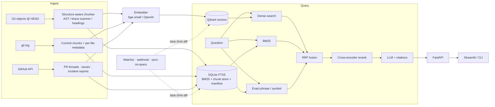

# 🧭 GitContext

**Ask questions about any Git repository and get answers grounded in its code, docs, commit history, PR
discussions and incident reports — with citations you can click.**

GitContext is an end-to-end RAG system for understanding unfamiliar or legacy codebases:
structure-aware chunking → embeddings in Qdrant → hybrid (vector + BM25 + exact-match) retrieval →
cross-encoder reranking → cited LLM answers, with automatic stale-index detection and incremental re-indexing.
Everything is Python: FastAPI backend, Typer CLI, Streamlit UI.



## What it does (mapped to the spec)

| Requirement | Implementation |
|---|---|
| Ingest source, README/docs, commits, PRs, incidents | `ingest/repo.py` (git objects, `git log`), `ingest/github.py` (PR threads incl. review comments, issues, incident-labelled issues), incident/postmortem markdown detected by path |
| Chunk by function/class/module, not token counts | `ingest/chunker.py`: Python **AST**; brace-depth scanner for JS/TS/Go/Java/Kotlin/C#/Rust/C/C++/PHP/Scala/Swift; indentation for Ruby; Markdown/RST by **heading path**. Only oversize units are windowed |
| Embeddings → vector DB | `index/embeddings.py` (fastembed `bge-small` local, OpenAI, offline hash) → `index/vectorstore.py` (**Qdrant**: embedded, in-memory or server) behind a 5-method `VectorStore` protocol |
| Hybrid retrieval | `retrieval/hybrid.py`: dense + **BM25** (SQLite FTS5, identifier-aware) + **exact phrase** (error messages) + **exact symbol**, fused with weighted **RRF** |
| Reranking | `retrieval/rerank.py`: cross-encoder (`ms-marco-MiniLM`) over the fused top-30, per-file diversity cap |
| Metadata | every chunk carries file path, lines, symbol, language, last author, last-modified date, last commit SHA, PR number, blob SHA, URL, top authors |
| Stale detection + auto re-index | manifest of `(path, blob SHA)`; `sync` re-indexes only changed/added files, drops deleted ones, appends new commits, pulls PR/issue updates. Triggers: `gitcontext watch`, API poller, `POST /webhook/github` (HMAC), `sync_on_query`; answers also flag **stale cited files** |
| FastAPI + web/CLI | `api.py`, `cli.py` (Typer), `ui/streamlit_app.py` |
| Evaluation | `evaluation/`: Recall@K, Precision@K, MRR, nDCG, answer correctness, citation accuracy, latency (p50/p95 per stage) |

## Quickstart

```bash
pip install -e ".[anthropic]"          # or: pip install -e ".[openai]"
cp .env.example .env                   # set GITCONTEXT_REPO, ANTHROPIC_API_KEY, (GITHUB_TOKEN)

gitcontext index                       # first run downloads two small ONNX models (~150 MB)
gitcontext ask "How does request retry work, and why was it changed?"
gitcontext search "ConnectionResetError" --k 5    # retrieval only, shows which ranker found each hit
gitcontext status                      # fresh / STALE + which files
gitcontext sync                        # re-index only what changed
gitcontext watch --interval 60         # keep the index fresh

gitcontext serve                       # FastAPI on :8000  (docs at /docs)
gitcontext ui                          # Streamlit on :8501 (talks to the API)
```

`GITCONTEXT_REPO` can be a local path, `owner/name`, or a GitHub URL (cloned under `.gitcontext/`).
Without an API key GitContext still works in **extractive mode** (returns the top evidence with citations).
Any OpenAI-compatible server (Ollama, vLLM) works via `GITCONTEXT_LLM_PROVIDER=openai` + `GITCONTEXT_OPENAI_BASE_URL`.

**Docker** (Qdrant server + API with auto-sync + UI): `docker compose up --build`.

> Embedded Qdrant locks its directory to one process. For API + CLI at the same time, use the Qdrant server
> (`GITCONTEXT_QDRANT_URL=http://localhost:6333`) or point the CLI at the API.

### API

| Endpoint | Purpose |
|---|---|
| `POST /query` `{question, top_k, mode, rerank, source_types, path_prefix}` | answer + `citations` + `evidence` + `timings_ms` + `index_status` + `warnings` |
| `POST /search` | retrieval only (hits with per-ranker ranks, rerank score) |
| `GET /status` | HEAD vs indexed commit, stale files, chunk counts, models |
| `POST /index` · `POST /sync` | full / incremental indexing (background job) |
| `POST /webhook/github` | `push`/`pull_request`/`issues` → background sync (`X-Hub-Signature-256` verified) |

## Design notes

**Chunking.** A 600-token window routinely cuts a function in half and mixes unrelated code. Here the unit
of retrieval is the thing an engineer would name: a function, a method (`Class.method`), a class (or class
header + method index when large), the module preamble (imports/constants), a doc section (`Install > Docker`).
Decorators and leading comments stay attached; Python docstrings are captured as metadata. Each chunk is embedded
with a one-line provenance header (`path:lines | symbol (kind)`), which measurably helps both embedder and reranker.

**Hybrid retrieval.** Dense vectors capture intent ("where do we back off on failures?"), but are weak on exact
strings. So the query is profiled: identifiers (`parse_user_id`, `HTTPClient`, `a.b.c`), quoted strings, and error
messages (`ValueError: invalid literal…`) are extracted and routed to additional rankers — a phrase/NEAR query
and an exact-symbol lookup — and BM25 indexes identifiers both whole *and* split (`parse user id`). Four ranked lists
are fused with weighted RRF (exact signals weigh more when present). RRF needs no score calibration across
incomparable scorers.

**Reranking.** The fused top-30 is rescored jointly (query, chunk) by a cross-encoder, then capped at 3 chunks per
file so one large module can't crowd out the PR that explains *why*.

**History as a first-class source.** Commits, PR threads (description + comments + reviews) and incident reports
are chunks too. "Why does X work this way?" is usually answered there, not in the code.

**Freshness.** Staleness is defined by content: `git ls-tree` blob SHAs at HEAD vs the manifest. That is robust to
rebases, force-pushes and reverts, needs no checkout, and makes `sync` cost proportional to the diff. Deleted files'
vectors and BM25 rows are removed; chunk IDs are deterministic so re-indexing is idempotent.

**Answer grounding.** The prompt requires `[n]` citations to numbered evidence blocks that include author/date/commit.
After generation, citations are validated against what was actually retrieved; invalid ones raise a warning.

## Evaluation

```bash
gitcontext eval generate --n 60          # synthetic set from the indexed repo (or hand-write JSONL, see evaluation/dataset.py)
gitcontext eval run --k 5                # retrieval ablation + latency
gitcontext eval run --answers            # + answer correctness & citation accuracy (needs an LLM key)
```

| Metric | Definition |
|---|---|
| **Recall@K** | fraction of gold chunks (keyed `path::symbol`, `commit:sha`, `pr:n`) in the top-K |
| **Precision@K** | fraction of the top-K that are gold (capped by 1/K for single-gold questions — compare configs, not absolutes) |
| **MRR / nDCG@10** | rank quality |
| **Answer correctness** | LLM-judge score vs. reference (0–1), key-fact coverage (required strings present), token-F1 |
| **Citation accuracy** | *validity* (cited `[n]` exists), *precision* (cited chunk is gold), *support* (cited sentence's content words appear in the cited chunk — a lexical faithfulness proxy), *coverage* (answer sentences with a citation) |
| **Latency** | p50/p95 end-to-end and per stage (embed, dense, lexical, fuse, rerank, generate) |

Question families: `semantic` (docstring paraphrase, symbol name masked → dense-favoured), `exact_error` (literal
`raise X("…")` text → lexical-favoured), `symbol`, `history` (commit subjects), `doc` (section headings).

EVAL_RESULTS_PLACEHOLDER

## Layout

```
src/gitcontext/
  ingest/       chunker.py  repo.py  github.py
  index/        embeddings.py  vectorstore.py  lexical.py  indexer.py
  retrieval/    hybrid.py  rerank.py
  evaluation/   metrics.py  dataset.py  runner.py
  rag.py llm.py engine.py api.py cli.py ui/streamlit_app.py
tests/          chunking · retrieval · freshness (git-level) · API/webhook · GitHub (mocked) · metrics
```

`pytest` runs fully offline (hash embedder + in-memory Qdrant + temp git repos).

## Extending

* **Other vector DBs** (Pinecone, Weaviate): implement `VectorStore` (`ensure/upsert/delete/search/count/reset`) in
  `index/vectorstore.py`; nothing else touches the DB. Only Qdrant is implemented and tested here.
* **Better code embeddings**: set `GITCONTEXT_EMBEDDING_MODEL` to any fastembed-supported model (then `index --rebuild`).
* **Tree-sitter**: swap `chunk_braces` for tree-sitter queries if you need exact grammars for more languages.

## Known limitations

* Brace-language chunking is heuristic (declaration regexes + brace depth), not a full parser; Python is exact.
* PR/issue ingestion needs `GITHUB_TOKEN` for anything beyond a toy rate limit (60 req/h), and fetches a bounded
  number of recent items (`github_max_prs`, `github_max_issues`).
* File-level "last modified" uses `git log` without rename tracking; blame-level (per-line) authorship is not indexed.
* The synthetic eval set has lexical leakage for `symbol`/`doc`/`history` questions by construction; use it for regression
  tracking and ablations, and add hand-written questions for absolute quality claims.
* Answer-level metrics that use an LLM judge are only as good as the judge; citation *support* is a lexical proxy.
